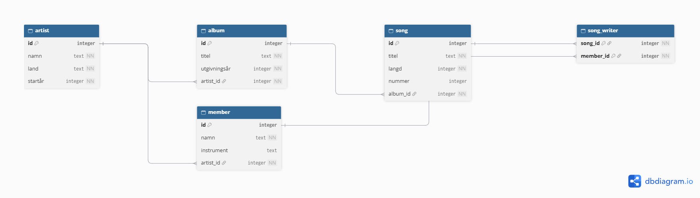

# SQL-inlämning — Diskografi

**Namn:** Martin  
**Artist:** Beatles  
**Datum:** 2026/10/13   

---

> Lägg länk till eller bild på ditt ER-diagram här:



---

## 1. Skapa databasen — CREATE TABLE

```sql
---
PRAGMA foreign_keys = ON;
CREATE TABLE "artist" (
	"id"	INTEGER NOT NULL,
	"namn"	TEXT NOT NULL,
	"land"	TEXT NOT NULL,
	"startår"	INTEGER NOT NULL,
	PRIMARY KEY("id" AUTOINCREMENT)
);
CREATE TABLE "album" (
	"id"	INTEGER NOT NULL,
	"titel"	TEXT NOT NULL,
	"utgivningsår"	INTEGER NOT NULL,
	"artist_id"	INTEGER NOT NULL,
	PRIMARY KEY("id" AUTOINCREMENT),
	FOREIGN KEY("artist_id") REFERENCES "artist"("id")
);
CREATE TABLE "song" (
	"id"	INTEGER NOT NULL,
	"titel"	TEXT NOT NULL,
	"langd"	INTEGER NOT NULL,
	"nummer"	INTEGER,
	"album_id"	INTEGER NOT NULL,
	PRIMARY KEY("id" AUTOINCREMENT),
	FOREIGN KEY("album_id") REFERENCES "album"("id")
);
CREATE TABLE "member" (
	"id"	INTEGER NOT NULL,
	"namn"	TEXT NOT NULL,
	"instrument"	TEXT,
	"artist_id"	INTEGER NOT NULL,
	PRIMARY KEY("id" AUTOINCREMENT),
	FOREIGN KEY("artist_id") REFERENCES "artist"("id")
);
CREATE TABLE "song_writer" (
	"song_id"	INTEGER NOT NULL,
	"member_id"	INTEGER NOT NULL,
	PRIMARY KEY("song_id","member_id"),
	FOREIGN KEY("member_id") REFERENCES "member"("id"),
	FOREIGN KEY("song_id") REFERENCES "song"("id")
);


```

---

## 2. Seeda med data — INSERT

```sql
INSERT INTO artist (namn,land, startår) VALUES ('Beatles','England',1960);

SELECT * FROM artist;

INSERT INTO album (titel,utgivningsår,artist_id) VALUES ('Revolver',1966,1);

INSERT INTO album (titel,utgivningsår,artist_id) VALUES ('Abbey Road',1969,1);

INSERT INTO album (titel,utgivningsår,artist_id) VALUES ('Rubber Soul',1965,1);

SELECT * FROM album;

INSERT INTO song (titel,langd,nummer,album_id) VALUES
('Taxman',158,1,1),
('Yellow Submarine',158,6,1),
('And Your Bird Can Sing',120,9,1),
('I Want You (She''s So Heavy)',467,6,2),
('Something',182,2,2),
('Octopus''s Garden',170,5,2),
('Michelle',162,7,3),
('You Won''t See Me',199,3,3),
('In My Life',146,11,3),
('Here Comes The Sun',185,7,2);

SELECT * FROM song;

INSERT INTO member (namn,instrument,artist_id) VALUES
('John Lennon','Gitarr',1),
('Paul McCartney','Bas',1),
('George Harrison','Gitarr',1),
('Ringo Starr','Trummor',1);

SELECT * FROM member;

INSERT INTO song_writer (song_id,member_id) VALUES
(1,3),
(2,1),
(2,2),
(3,1),
(3,2),
(4,1),
(4,2),
(5,3),
(6,4),
(7,1),
(7,2),
(8,1),
(8,2),
(9,1),
(9,2),
(10,3);

SELECT * FROM song_writer;

```

---

## 3. Söka — SELECT

```sql
--- query 1: Lista alla album, sorterade efter år ---
SELECT titel,utgivningsår FROM album ORDER BY utgivningsår;

--- query 2: Lista alla låtar på ett specifikt album ---
SELECT song.titel FROM album
JOIN song ON song.album_id = album.id
WHERE album.titel = 'Abbey Road';

--- query 3: Antal låtar per album ---
SELECT COUNT(song.id),album.titel FROM album
JOIN song ON album.id = album_id
GROUP BY album.id;

--- query 4: Längsta låten ---
SELECT titel FROM song ORDER BY langd DESC LIMIT 1;

--- query 5: Alla låtar sorterade alfabetiskt ---
SELECT titel FROM song ORDER BY titel;
```

---

## 4. Lägg till en ny rad — INSERT

```sql
--- lägg till ett nytt album eller en ny låt ---
INSERT INTO album (titel,utgivningsår,artist_id) VALUES ('Let it be',1970,1);
```

---

## 5. Ta bort en rad — DELETE

```sql
--- ta bort en rad ur valfri tabell ---
DELETE FROM album WHERE titel = 'Let it be';
```

---

## 6. Uppdatera en rad — UPDATE

```sql
--- uppdatera minst en rad i valfri tabell ---
UPDATE song SET langd = 183 WHERE id = 5;
```

---

## 7. VG-queries (om du siktar på VG)

```sql
--- query 6: Snittlängd på låtar per album ---
SELECT AVG(song.langd),album.titel FROM album
JOIN song ON album.id = album_id
GROUP BY album.id;

--- query 7: Albumet med flest låtar --- 
	SELECT album.titel FROM album
	JOIN song ON album.id = album_id
	GROUP BY album_id
	ORDER BY COUNT(song.langd) DESC LIMIT 1;

--- query 8: Alla låtar längre än 4 minuter (240 sekunder), med albumtitel ---

SELECT song.titel,album.titel FROM album
JOIN song ON album.id = album_id
WHERE song.langd > 240;

```
## VG förklaringar:

## Tabellstruktur
Jag har valt 5 tabeller: album,artist,member,song,song_writer. Artist innehåller bandet (beatles i detta fall), album innehåller deras skivor, song vissa av låtarna på skivorna, member bandmedlemmarna och song_writer kopplar ihop vilka medlemmar som skrivit vilka låtar. 

Varje tabell har ett `id` som PrimaryKey, så att varje rad är unik. Tabellerna kopplas ihop med ForeignKeys:

album.artist_id pekar på artist.id - ett album hör till en artist
song.album_id pekar på album.id - en låt ligger på ett album
member.artist_id pekar på artist.id - en medlem hör till en artist

En låt kan skrivas av flera medlemmar och en medlem kan skriva flera låtar. Därav song_writer som bara innhåller song_id och member_id där är primärnyckeln båda kolumnerna tillsammans, så samma par
inte kan läggas in två gånger.

Databasen blir i 3NF då varje upgift bara finns på ett ställe. Til exempel finns albumets titel i album istället för i varje låt.

## Join
En JOIN används för att hämta data från två tabeller samtidigt genom att koppla ihop raderna med hjälp av Keys. Till exempel JOIN song ON song.album_id = album.id matchar varje låt med det album som har samma id som låtens album.